  

# Nandan S — Software Engineer

  <strong>Backend Engineering · Applied AI/ML · Reliable Systems</strong> 
  Building software where data, models, APIs, and operational safeguards work together.

  
  
  

---

## About

I'm a Computer Science Engineering student at **PES College of Engineering, Mandya (2027)**, focused on backend systems, applied machine learning, and dependable software.

My work spans quantitative research tooling, financial decision systems, reconciliation, evidence-aware talent intelligence, network simulation, and AI-assisted developer tools. I care about the engineering underneath the interface: data contracts, deterministic calculations, failure handling, traceability, security boundaries, and tests that exercise real behavior.

Currently interested in **Backend / Software Engineering** and **AI Engineering** opportunities.

## Engineering work

### [NSE Options Research Lab (NSE-ORL)](https://github.com/NANDANS26/NSE-Options-Research-Lab)

An offline-capable Indian derivatives research and backtesting platform for historical strategy evaluation, realistic execution simulation, transaction-cost modelling, and quantitative risk analysis.

- **Indian market realism:** models STT, exchange turnover charges, SEBI fees, stamp duty, GST, bid–ask spreads, slippage, and stop-loss gap fills.
- **Risk controls:** daily-loss circuit breakers, position limits, drawdown cutoffs, entry cooldowns, and mandatory 15:15 IST square-off.
- **Research methods:** chronological walk-forward out-of-sample validation, cost-sensitivity analysis, and Monte Carlo resampling.
- **Data & performance:** one-minute spot and options data, Parquet storage, Polars, and PyArrow; CPU-first and usable without GPU or external LLM credentials.
- **Interfaces:** Python research engine and CLI, FastAPI service, and React + TypeScript dashboard.
- **Verification:** the repository documents 117 passing unit and integration tests.

This project is **derived from Bhav by Raj Maurya (@rajmaurya0904), with attribution**. I maintain and extend the research platform; I do not claim the upstream foundation as wholly original work.

### [Averiq — AI Revenue Recovery Decision Engine](https://github.com/NANDANS26/averiq)

A payment-recovery decision platform that estimates intervention value against an organic-recovery baseline, applies deterministic policy guardrails, and routes risky decisions through human approval.

- Calibrated LightGBM T-Learner for intervention-value estimation.
- Counterfactual no-intervention baseline and net incremental surplus ranking.
- Integer-paise accounting, idempotency controls, Redis locking, and auditable execution.
- FastAPI, PostgreSQL, Redis, Celery, React, and TypeScript.

### [ReconPilot — Financial Reconciliation & Exception Investigation](https://github.com/NANDANS26/ReconPilot)

A finance-control workflow that separates deterministic financial truth from ML-assisted investigation.

- Deterministic matching with Python Decimal arithmetic and PostgreSQL numeric storage.
- Evidence dossiers with canonicalization and SHA-256 integrity fingerprints.
- Local CatBoost root-cause classification with confidence and abstention gates.
- Dual-control approvals and separation-of-duties checks; no automatic ledger mutation.

### [SkillVerse — Evidence-Aware Learning & Workforce Intelligence](https://github.com/NANDANS26/SkillVerse)

A platform connecting verified competency evidence, personalized learning roadmaps, and employer-side candidate discovery.

- Evidence-weighted Skill DNA and faculty verification workflows.
- SentenceTransformer embeddings and semantic recommendations.
- FAISS retrieval followed by LightGBM candidate re-ranking.
- Six-role RBAC, PostgreSQL, FastAPI, Node.js, React, and TypeScript.

### [Protocol-Aware Network Digital Twin](https://github.com/NANDANS26/protocol-aware-network-digital-twin)

A network analysis and security-verification platform combining systems programming with deterministic simulation.

- C++20 protocol analysis and stateful flow tracking.
- Evidence-based topology reconstruction and versioned digital-twin snapshots.
- Security invariant verification, isolated fuzzing, and differential testing.
- Reproducible investigations with cryptographic evidence integrity.

### [SIREN — Security Incident Response Environment](https://github.com/NANDANS26/SIREN)

An OpenEnv-compatible reinforcement-learning environment where agents learn incident-response action sequences against interconnected systems.

- Partial observability with logs and indicators revealed through inspection actions.
- Attack-chain propagation, isolation, patching, and escalation decisions.
- Grading combines incident outcomes with sequence alignment to expert traces.
- Python, FastAPI, and Docker.

### [FORGE-AI / DataFactory](https://github.com/NANDANS26/FORGE-AI) · private project

A modular data-manufacturing platform that turns natural-language data requirements into validated, documented data products.

- FastAPI backend with Polars, DuckDB, and PyArrow.
- React and TypeScript analytical client.
- Domain packs, shared contracts, and staged ingestion, matching, and planning workflows.

### More projects

- [MIRROR X AI](https://github.com/NANDANS26/MIRROR-X-AI) — multimodal interface analysis for identifying and explaining potentially manipulative UX patterns.
- [RepoGenie](https://github.com/NANDANS26/RepoGenie) — AI-assisted generation of editable project reports with PDF, DOCX, and PPTX export.
- [PagePulse](https://github.com/NANDANS26/page-pulse) — website audits across SEO, performance, and accessibility.
- [ResumeSmith](https://github.com/NANDANS26/ResumeSmith) — browser-based resume and academic CV builder; this is a fork of the upstream project, with a submitted fix described below.
- [GDG PESCE Website](https://github.com/NANDANS26/gdg-website) — React, TypeScript, and Three.js website for the college developer community.
- [Athlete Management](https://github.com/NANDANS26/Athlete-Management) — athlete and coach workflows with performance data and wearable integrations.

---

## Open-source contributions

I contribute fixes and features to upstream projects, with PR status stated explicitly. The links below point to the canonical upstream pull requests.

### Merged pull requests

| Project | PR | Contribution |
|---|---|---|
| Rocketflare | [#79 — Bounded concurrent tool execution](https://github.com/rocketflare-dev/rocketflare/pull/79) | Added configurable bounded concurrency for independent agent tool calls while preserving model-request ordering, budgets, approvals, and sequential execution when the cap is one. |
| ProofLens | [#14 — Namespaced property labels](https://github.com/jdhart81/prooflens/pull/14) | Preserved fully qualified predicate names through MathIR lowering so semantic labels resolve correctly; added regression coverage and documentation. |
| ProofLens | [#34 — Function.Injective visualization](https://github.com/jdhart81/prooflens/pull/34) | Added deterministic classification and implication-graph visualization for Function.Injective declarations, preserving derived status and rule provenance. |
| ProofLens | [#35 — TorchLean 360-example certification](https://github.com/jdhart81/prooflens/pull/35) | Extended exact-real robustness certification across 360 examples, using exact decimal-to-BigInt parsing and kernel-checked outward-rounded interval enclosures for 3,600 output bounds. |

### Open pull requests

| Project | PR | Contribution |
|---|---|---|
| Rocketflare | [#80 — Unknown tool outcomes](https://github.com/rocketflare-dev/rocketflare/pull/80) | Recovery handling that surfaces uncertain tool outcomes rather than blindly replaying potentially side-effecting calls. |
| Rocketflare | [#81 — TypeScript AST plugin checks](https://github.com/rocketflare-dev/rocketflare/pull/81) | Replaces fragile source-text checks with TypeScript AST-based validation and project-aware import resolution. |
| Rocketflare | [#82 — Comment-only kit upgrade hunks](https://github.com/rocketflare-dev/rocketflare/pull/82) | Safely applies comment-only changes in manual configuration files while leaving substantive edits for review. |
| Co-Op | [#28 — Decouple Firecrawl from local core validation](https://github.com/Afnanksalal/co-op/pull/28) | Keeps local assistant functionality usable when optional web research is not configured. |
| Co-Op | [#29 — Honest lead discovery status](https://github.com/Afnanksalal/co-op/pull/29) | Distinguishes unverified source candidates from verified, emailable contacts and keeps outreach fail-closed. |
| Co-Op | [#30 — Embedding observability and batching](https://github.com/Afnanksalal/co-op/pull/30) | Adds provider batching, explicit fallback visibility, and safer reindex progress and failure reporting. |
| Co-Op | [#31 — Secret trust and guardrail logging](https://github.com/Afnanksalal/co-op/pull/31) | Documents secret-storage trust boundaries and adds regression coverage for safe guardrail logging. |
| Co-Op | [#32 — Non-fatal local failure visibility](https://github.com/Afnanksalal/co-op/pull/32) | Surfaces local memory and indexing failures to the user without failing otherwise successful workflows. |
| RepoGenie | [#1 — Local Ollama Phi-3 provider](https://github.com/NANDANS26/RepoGenie/pull/1) | Replaces the Gemini REST provider with configurable local Ollama inference and makes provider failures explicit. |

<strong>Other submitted pull requests — closed without merge</strong>

These are recorded separately and are **not counted as merged contributions**:

- [Rocketflare #73 — Per-agent execution policies](https://github.com/rocketflare-dev/rocketflare/pull/73)
- [Rocketflare #74 — Per-turn tool-loop usage accounting](https://github.com/rocketflare-dev/rocketflare/pull/74)
- [Rocketflare #75 — Durable run approvals](https://github.com/rocketflare-dev/rocketflare/pull/75)
- [LangChain #40930 — Respect limit=0 in InMemoryRecordManager.list_keys](https://github.com/langchain-ai/langchain/pull/40930)
- [ResumeSmith #74 — Prevent stale O*NET search responses](https://github.com/YoyoJesus/ResumeSmith/pull/74)

---

## Engineering toolkit

| Area | Tools and technologies |
|---|---|
| Languages | Python, TypeScript, JavaScript, C, C++ |
| Backend | FastAPI, Node.js, Express, REST APIs |
| Frontend | React, Vite, Tailwind CSS |
| Data & ML | PostgreSQL, Redis, DuckDB, Polars, PyArrow, scikit-learn, LightGBM, CatBoost, FAISS, SentenceTransformers |
| Infrastructure | Docker, Git, GitHub Actions, Linux |
| Engineering practices | API contracts, RBAC, deterministic financial logic, idempotency, event-driven workflows, integration testing |

## Achievements & learning

- **Winner** — GDG Impact Challenge.
- **2nd Place** — Hacksketra 2024.
- **Google Cloud Generative AI Study Jam** — 15 skill badges and 60+ hands-on labs (2024).

## Education

**B.E. Computer Science & Engineering**  
PES College of Engineering, Mandya · 2023–2027

## Find me

- LinkedIn: [nandan-s](https://www.linkedin.com/in/nandan-s-9279952a1/)
- LeetCode: [nandansdev](https://leetcode.com/u/nandansdev/)
- GitHub: [@NANDANS26](https://github.com/NANDANS26)

---

Build carefully. Test failure paths. Make systems understandable.

